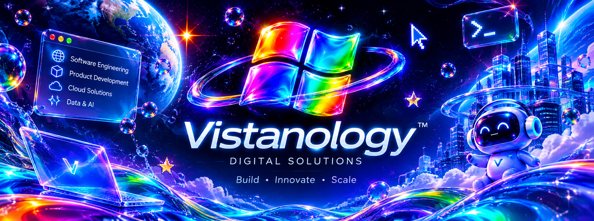

  

  <strong>BUILD · INNOVATE · SCALE</strong> 
  <em>Software engineering. Digital products. Connected possibilities.</em>

  <a href="#pt-br">Português</a> &nbsp;·&nbsp;
  <a href="#english">English</a>

🇧🇷 Sobre a Vistanology
A Vistanology é uma empresa de tecnologia dedicada a projetar, desenvolver e evoluir soluções digitais. Unimos engenharia de software, visão de produto e tecnologias modernas para transformar necessidades reais em experiências e sistemas úteis, confiáveis e preparados para crescer.

Acreditamos que tecnologia não deve existir apenas para parecer inovadora. Ela precisa resolver problemas, simplificar processos e criar possibilidades — com intenção em cada detalhe, da primeira ideia à evolução contínua.
O que fazemos
Área	Como atuamos
Engenharia de software	Arquitetura, desenvolvimento e evolução de sistemas sob medida.
Web & mobile	Aplicações e experiências digitais para diferentes plataformas.
Backend & integrações	APIs, serviços, automações e comunicação entre sistemas.
Dados & plataformas	Modelagem, bancos de dados e estruturas para trabalhar com informação.
Cloud & DevOps	Infraestrutura, automação de entregas e fundamentos para operar com consistência.
Qualidade & segurança	Testes, confiabilidade e atenção à segurança durante o ciclo de desenvolvimento.

Nossa maneira de construir
- Entender antes de implementar. Cada solução começa pelo problema e pelo contexto.
- Engenharia com propósito. Arquitetura, clareza e manutenção importam tanto quanto a entrega.
- Qualidade desde o início. Testes, revisão e segurança fazem parte do processo.
- Evoluir com responsabilidade. Construímos bases que possam ser compreendidas, aprimoradas e escaladas.
Tecnologias
Nosso trabalho pode envolver tecnologias como:

Python FastAPI Django Node.js JavaScript TypeScript React React Native PostgreSQL Redis Firebase Docker GitHub Actions Linux Grafana Prometheus Datadog

A escolha da stack acompanha as necessidades de cada produto — não o contrário.
Liderança
Fundada por César Rodrigues Ribeiro — @nuwget —, a Vistanology nasce da combinação entre engenharia de software, curiosidade técnica e vontade de transformar boas ideias em soluções concretas.
Contato & colaboração
Para conversas sobre projetos, parcerias ou colaboração técnica, entre em contato pelo GitHub da liderança.

🇺🇸 About Vistanology
Vistanology is a technology company focused on designing, building, and evolving digital solutions. We bring together software engineering, product thinking, and modern technologies to turn real needs into useful, reliable systems and experiences built to grow.

We believe technology should be more than innovation for its own sake. It should solve problems, simplify processes, and create new possibilities — with intention in every detail, from the first idea to continuous improvement.
What we do
Area	How we work
Software engineering	Architecture, development, and continuous improvement of custom software.
Web & mobile	Digital applications and experiences across platforms.
Backend & integrations	APIs, services, automation, and system interoperability.
Data & platforms	Data modeling, databases, and foundations for information-driven products.
Cloud & DevOps	Infrastructure, delivery automation, and reliable operations foundations.
Quality & security	Testing, reliability, and security throughout the development lifecycle.

How we build
- Understand before building. Every solution starts with the problem and its context.
- Purposeful engineering. Architecture, clarity, and maintainability matter as much as delivery.
- Quality by design. Testing, code review, and security are part of the process.
- Responsible evolution. We build foundations that can be understood, improved, and scaled.

We choose the stack to fit the product — never the other way around.
Leadership
Vistanology was founded by César Rodrigues Ribeiro — @nuwget —, bringing together software engineering, technical curiosity, and a drive to turn thoughtful ideas into tangible solutions.
Contact & collaboration
For project discussions, partnerships, or technical collaboration, reach out through the founder's GitHub profile.

  <strong>VISTANOLOGY</strong> 
  Digital Solutions · Build. Innovate. Scale.

